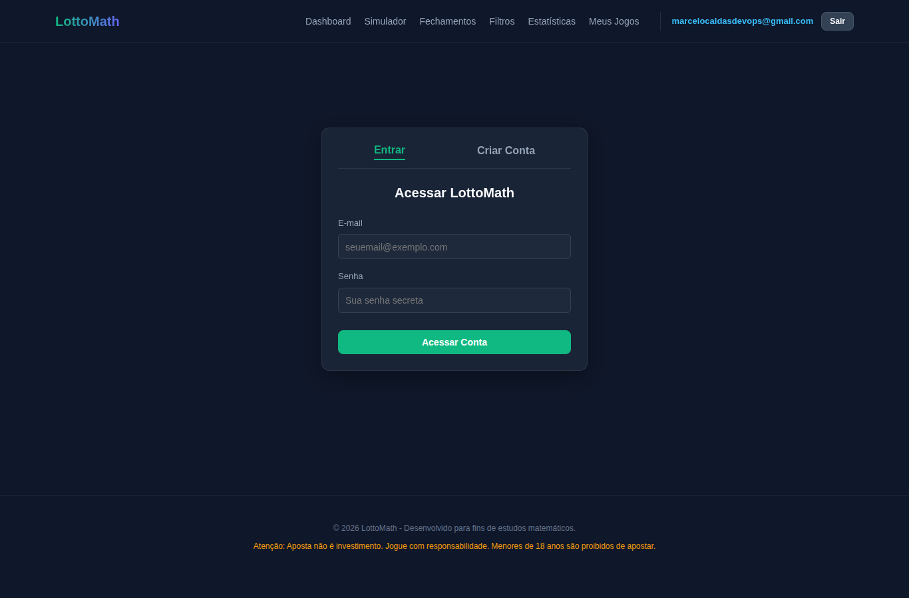
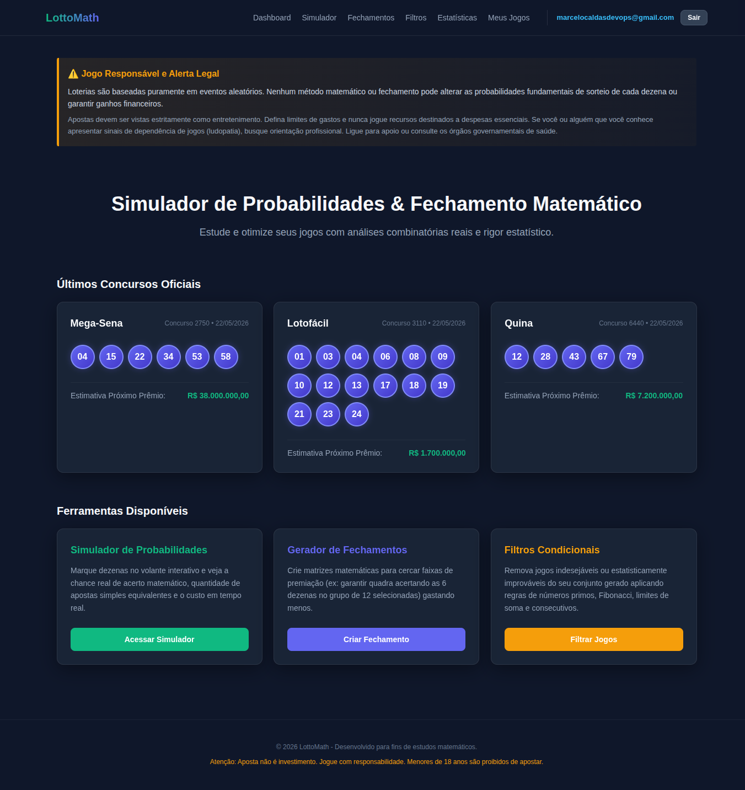
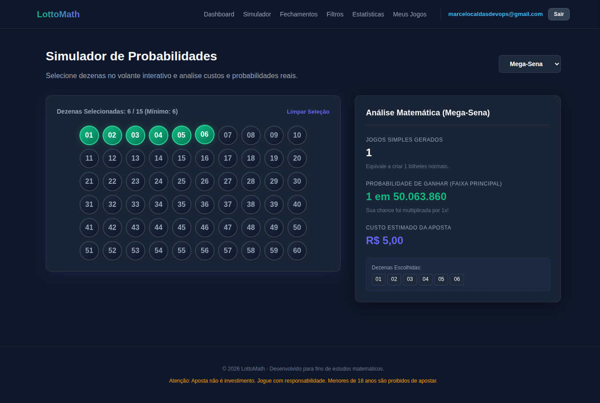
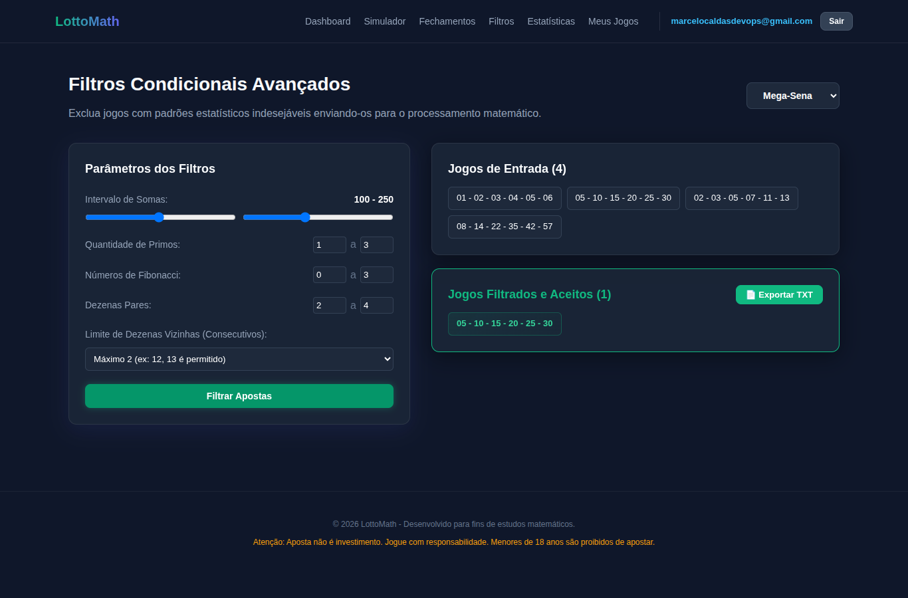
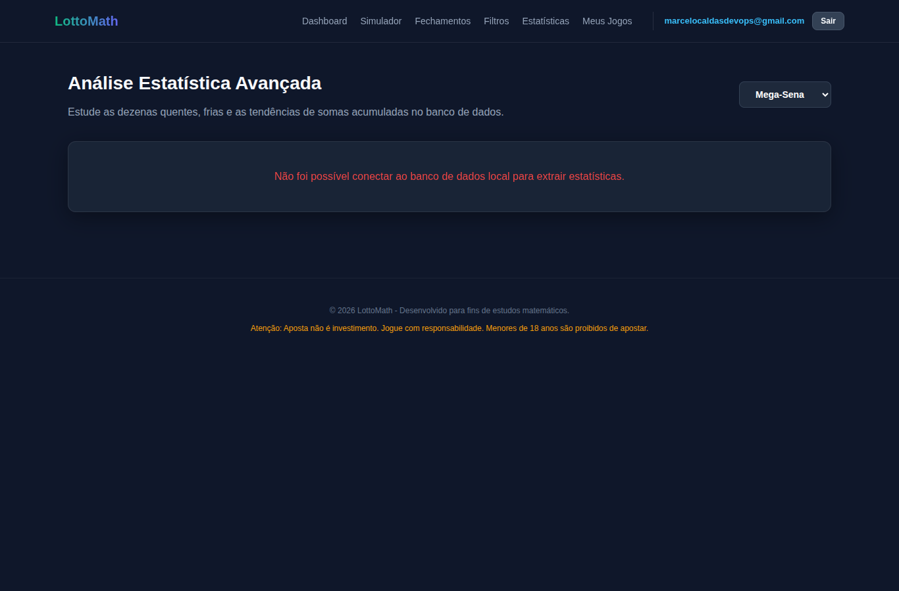
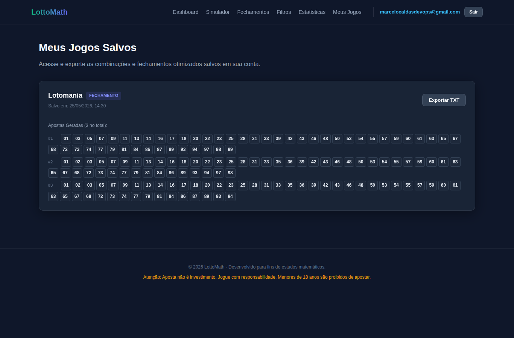

# Documentacao do Sistema LottoMath

Documentacao funcional gerada a partir de navegacao Playwright no sistema em `http://localhost:3000/`.

## Menu

- [1. Login](#login)
- [2. Dashboard](#dashboard)
- [3. Simulador](#simulador)
- [4. Fechamentos](#fechamentos)
- [5. Filtros](#filtros)
- [6. Estatisticas](#estatisticas)
- [7. Meus Jogos](#meus-jogos)

## Sumario

| # | Tela | Caminho | Descricao resumida |
|---|------|---------|--------------------|
| 1 | Login | `/login` | Permite autenticar o usuario no sistema. |
| 2 | Dashboard | `/` | Apresenta alerta de jogo responsavel, ultimos concursos e atalhos das ferramentas. |
| 3 | Simulador | `/simulador` | Permite selecionar dezenas e calcular probabilidade, custo e jogos simples equivalentes. |
| 4 | Fechamentos | `/fechamento` | Gera matrizes de apostas otimizadas com parametros de garantia. |
| 5 | Filtros | `/filtros` | Aplica filtros condicionais em jogos de entrada e lista os jogos aceitos. |
| 6 | Estatisticas | `/estatisticas` | Exibe a area de analise estatistica por modalidade. |
| 7 | Meus Jogos | `/jogos-salvos` | Lista jogos salvos da conta autenticada e permite exportacao. |

---

## 1. Login

**Caminho:** `/login`

**Screenshot:**

**Descricao:**

Tela usada para autenticar usuarios e liberar o acesso as funcionalidades protegidas do sistema. A tela tambem oferece alternancia para criacao de conta.

**Elementos principais:**

- Campo E-mail: identifica o usuario.
- Campo Senha: recebe a senha de acesso.
- Botao `Acessar Conta`: envia as credenciais para autenticacao.
- Aba `Entrar`: mantem o formulario em modo de login.
- Aba `Criar Conta`: acao indicada pela interface, nao validada durante a navegacao.
- Links do menu superior: `Dashboard`, `Simulador`, `Fechamentos`, `Filtros`, `Estatisticas` e `Entrar`.

**Validacao Playwright:**

- Login realizado com sucesso.
- Requisicao `POST http://localhost:8000/api/v1/auth/login` retornou `200`.
- Apos autenticar, o sistema redirecionou para `/` e exibiu o botao `Sair`.

---

## 2. Dashboard

**Caminho:** `/`

**Screenshot:**

**Descricao:**

Pagina inicial do LottoMath. Apresenta aviso legal sobre jogo responsavel, resultados recentes de concursos oficiais e cards de acesso rapido para as ferramentas principais.

**Elementos principais:**

- Secao `Jogo Responsavel e Alerta Legal`: informa que loterias sao eventos aleatorios e nao ha garantia de ganhos.
- Secao `Ultimos Concursos Oficiais`: exibe concursos e dezenas recentes de Mega-Sena, Lotofacil e Quina.
- Secao `Ferramentas Disponiveis`: apresenta atalhos para simulacao, fechamentos e filtros.
- Menu superior autenticado: `Dashboard`, `Simulador`, `Fechamentos`, `Filtros`, `Estatisticas`, `Meus Jogos` e `Sair`.

**Validacao Playwright:**

- Rota retornou `200`.
- Tela carregou o conteudo principal e manteve o menu autenticado visivel.

---

## 3. Simulador

**Caminho:** `/simulador`

**Screenshot:**

**Descricao:**

Tela usada para selecionar dezenas em um volante interativo e calcular a analise matematica da aposta conforme a modalidade escolhida.

**Elementos principais:**

- Seletor de modalidade: `Mega-Sena`, `Lotofacil`, `Quina`, `Lotomania` e `Dupla-Sena`.
- Volante numerico: botoes de dezenas selecionaveis.
- Contador `Dezenas Selecionadas`: mostra quantidade selecionada, limite e minimo da modalidade.
- Botao `Limpar Selecao`: limpa as dezenas marcadas.
- Painel `Analise Matematica`: mostra jogos simples gerados, probabilidade, multiplicador de chance, custo estimado e dezenas escolhidas.

**Validacao Playwright:**

- Rota retornou `200`.
- Foram selecionadas as dezenas `01 02 03 04 05 06` na Mega-Sena.
- A tela exibiu `1` jogo simples gerado.
- A probabilidade exibida foi `1 em 50.063.860`.
- O custo estimado exibido foi `R$ 5,00`.
- Requisicao `POST http://localhost:8000/api/v1/analise/probabilidade` retornou `200`.

---

## 4. Fechamentos

**Caminho:** `/fechamento`

**Screenshot:**

**Descricao:**

Tela usada para gerar fechamentos matematicos a partir de dezenas selecionadas e parametros de garantia. O resultado apresenta cartoes otimizados e acoes para salvar, filtrar ou exportar.

**Elementos principais:**

- Seletor de modalidade: define a loteria usada no fechamento.
- Campo `Garantia de Acerto (K)`: define a faixa de premio garantida.
- Campo `Se acertarmos (T)`: define a condicao de acerto usada na matriz.
- Contador `Dezenas Selecionadas`: informa quantidade selecionada e limites.
- Botao `Gerar Fechamento`: executa a geracao da matriz.
- Volante numerico: permite marcar as dezenas de entrada.
- Botao `Limpar`: remove as dezenas selecionadas.
- Resultado `Jogos Otimizados Gerados`: lista os cartoes calculados.
- Botao `Salvar no Sistema`: acao indicada pela interface, nao validada durante a navegacao.
- Botao `Filtrar Resultados`: acao indicada pela interface, nao validada durante a navegacao.
- Botao `Exportar TXT`: acao indicada pela interface, nao validada durante a navegacao.

**Validacao Playwright:**

- Rota retornou `200`.
- Foram selecionadas as dezenas `01 02 03 04 05 06` na Mega-Sena.
- O botao `Gerar Fechamento` gerou `1` cartao otimizado.
- A tela exibiu custo total estimado de `R$ 5,00`.
- A tela exibiu mensagem de sucesso `Fechamento Gerado!`.
- Requisicao `POST http://localhost:8000/api/v1/fechamentos/gerar` retornou `200`.

---

## 5. Filtros

**Caminho:** `/filtros`

**Screenshot:**

**Descricao:**

Tela usada para aplicar regras condicionais em jogos de entrada e manter apenas as combinacoes que passam nos filtros configurados.

**Elementos principais:**

- Seletor de modalidade: define a loteria dos jogos filtrados.
- Filtro `Intervalo de Somas`: ajusta soma minima e maxima permitida.
- Filtro `Quantidade de Primos`: define faixa aceitavel de dezenas primas.
- Filtro `Numeros de Fibonacci`: define faixa aceitavel de dezenas pertencentes a sequencia de Fibonacci.
- Filtro `Dezenas Pares`: define faixa aceitavel de dezenas pares.
- Campo `Limite de Dezenas Vizinhas`: define o maximo de numeros consecutivos permitidos.
- Botao `Filtrar Apostas`: executa a filtragem.
- Secao `Jogos de Entrada`: lista os jogos antes da filtragem.
- Secao `Jogos Filtrados e Aceitos`: lista os jogos aprovados.
- Botao `Exportar TXT`: acao indicada pela interface, nao validada durante a navegacao.

**Validacao Playwright:**

- Rota retornou `200`.
- O botao `Filtrar Apostas` foi acionado com parametros padrao.
- A tela exibiu `1` jogo aceito entre `4` jogos de entrada.
- Jogo aceito exibido: `05 - 10 - 15 - 20 - 25 - 30`.
- Requisicao `POST http://localhost:8000/api/v1/fechamentos/filtrar` retornou `200`.

---

## 6. Estatisticas

**Caminho:** `/estatisticas`

**Screenshot:**

**Descricao:**

Tela de analise estatistica por modalidade. A interface indica estudo de dezenas quentes, frias e tendencias de somas acumuladas a partir do banco de dados local.

**Elementos principais:**

- Seletor de modalidade: `Mega-Sena`, `Lotofacil`, `Quina`, `Lotomania` e `Dupla-Sena`.
- Area de conteudo estatistico: deve exibir dados calculados quando a API estiver disponivel.
- Mensagem de indisponibilidade: informa falha ao conectar ou obter estatisticas do banco local.

**Validacao Playwright:**

- Rota retornou `200`.
- A tela carregou o titulo `Analise Estatistica Avancada`.
- A requisicao `GET http://localhost:8000/api/v1/analise/mega-sena/estatisticas` retornou `404`.
- A interface exibiu `Nao foi possivel conectar ao banco de dados local para extrair estatisticas.`.

---

## 7. Meus Jogos

**Caminho:** `/jogos-salvos`

**Screenshot:**

**Descricao:**

Tela autenticada usada para visualizar apostas e fechamentos salvos na conta do usuario. Permite consultar uma pre-visualizacao dos jogos e exportar a listagem.

**Elementos principais:**

- Card de jogo salvo: apresenta modalidade, tipo, data de salvamento e apostas geradas.
- Lista de apostas: exibe uma amostra das combinacoes salvas.
- Botao `Exportar TXT`: permite exportar os jogos salvos em arquivo de texto.
- Menu superior autenticado com botao `Sair`.

**Validacao Playwright:**

- Rota `/jogos-salvos` retornou `200`.
- A tela exibiu jogos salvos da modalidade `Lotomania`.
- A tela exibiu `3` apostas visiveis no card validado.
- Requisicao `GET http://localhost:8000/api/v1/jogos/` retornou `200`.
- A rota `/meus-jogos` foi testada separadamente e retornou `404`; o menu real aponta para `/jogos-salvos`.

---

## Observacoes Tecnicas Dos Testes

- `GET /favicon.ico` retornou `404`.
- `GET /api/v1/analise/mega-sena/estatisticas` retornou `404` e impede a exibicao das estatisticas reais.
- Em viewport mobile de `390x844`, o menu superior gerou rolagem horizontal, com largura aproximada de `786px`.
- Nenhuma credencial foi registrada neste documento ou nos screenshots.
