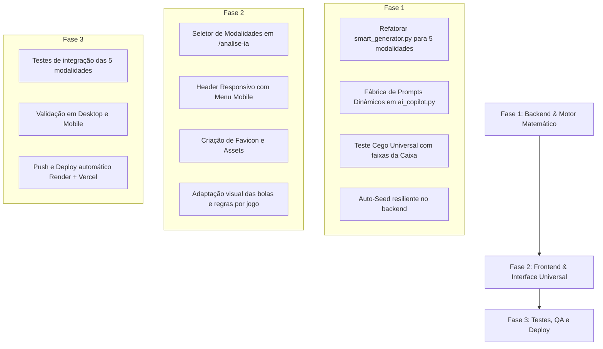

# Plano Mestre de Arquitetura e Expansão de IA: LottoMath v2.0

> **Planejamento gerado com o subagente Gemini 4 Argon**  
> *Data:* 15/10/2026  
> *Escopo:* Expansão Universal do Motor de IA para todas as 5 modalidades, Refatoração Heurística de Scoring e Saneamento de Débitos Técnicos (Header Mobile, Favicon, Auto-Seed).

---

## 1. Visão Geral e Diagnóstico Arquitetural (*As-Is*)

O sistema LottoMath atualmente possui o módulo `/analise-ia`, porém uma inspeção técnica profunda revelou forte acoplamento estrutural à **Lotofácil**:

| Componente | Estado Atual (*As-Is*) | Gargalo Arquitetural |
| :--- | :--- | :--- |
| **`smart_generator.py`** | Contém apenas a função `avaliar_jogo_lotofacil`. | Hardcoded para grade $5 \times 5$ (25 dezenas), 15 apostadas, validação de Moldura/Centro e soma entre 180-220. Incompatível com apostas de 5, 6 ou 50 dezenas. |
| **`ai_copilot.py`** | Dicionário estático `PROMPT_TEMPLATES`. | Exporta prompts literais com o texto "Lotofácil" e "15 dezenas de 01 a 25", mesmo quando o usuário seleciona outra modalidade. |
| **`analysis.py` (`/teste-cego`)** | Valida acertos apenas contra `[11, 12, 13, 14, 15]`. | Cego para Quadras/Quinas/Senas da Mega-Sena, Duques/Ternos da Quina, os 0 acertos da Lotomania e o duplo sorteio da Dupla-Sena. |
| **`analysis.py` (`/estatisticas`)** | Lança `HTTPException(status_code=404)` quando `count(Sorteio) == 0`. | Quebra a interface do usuário caso a modalidade selecionada ainda não tenha histórico persistido no banco local. |
| **`/analise-ia/page.tsx`** | Chamadas da API fixadas no literal `'lotofacil'`. | Sem seletor de modalidade, impedindo o usuário de alternar entre as 5 loterias na área de IA. |
| **`Header.tsx` & Assets** | `<nav>` com `flex` sem colapso mobile; ausência de `favicon.ico`. | Overflow horizontal em telas menores que 768px (~786px de largura forçada em viewports de 390px) e erro 404 em `/favicon.ico`. |

---

## 2. Matriz de IA por Modalidade

O subsistema de IA opera em **três pilares** para todas as 5 modalidades:
1. **Gerador Inteligente (*Smart Scoring Engine*):** Algoritmo de Monte Carlo guiado com função objetivo multicritério $S(J) \in [0, 100]$ pontos.
2. **Engenharia de Prompts Contextual:** Injeção dinâmica de histórico real e regras combinatórias para LLMs (DeepSeek, ChatGPT, Gemini).
3. **Simulador de Teste Cego (*Backtesting Engine*):** Omissão do último concurso com auditoria das faixas reais de premiação da Caixa.

---

### 2.1. Mega-Sena (`mega-sena`)
* **Universo:** 60 dezenas ($01$ a $60$) | **Aposta padrão:** 6 dezenas (suporta até 20) | **Volante:** $6 \times 10$.

#### Onde a IA entra:
- **Gerador Inteligente (Scoring 100 pts):**
  - **Quadrantes no volante $6 \times 10$ (25 pts):** Presença em 3 ou 4 quadrantes distintos e máximo de 3 dezenas no mesmo quadrante.
  - **Equilíbrio Par/Ímpar (20 pts):** 3P/3I (20 pts), 4P/2I ou 2P/4I (16 pts). Proporção entre 33% e 67% para apostas múltiplas.
  - **Soma das Dezenas (20 pts):** Faixa Ouro $[130, 220]$ para 6 dezenas (média teórica: 183). Escalonado proporcionalmente se $k > 6$.
  - **Repetidas do Concurso Anterior (15 pts):** 0 ou 1 repetida (cobre ~85% da probabilidade histórica).
  - **Números Primos (10 pts):** 1 a 3 primos entre as 17 dezenas primas de 1 a 60.
  - **Sequências e Linhas (10 pts):** Máximo de 2 números contíguos e máximo de 2 por linha horizontal.
- **Engenharia de Prompts:**
  - *Prompt "Estrategista de Quadrantes & Ciclos":* Persona de estatístico combinatório que analisa o grid $6 \times 10$, atrasos por quadrante e média móvel de somas, gerando combinações equilibradas de 6 dezenas.
- **Teste Cego:**
  - Conferência automática das faixas oficiais: **Quadra (4)**, **Quina (5)** e **Sena (6 - Prêmio Máximo)**.

---

### 2.2. Lotofácil (`lotofacil`)
* **Universo:** 25 dezenas ($01$ a $25$) | **Aposta padrão:** 15 dezenas (suporta até 20) | **Volante:** $5 \times 5$.

#### Onde a IA entra:
- **Gerador Inteligente (Scoring 100 pts):**
  - **Moldura vs Centro (25 pts):** 9 ou 10 na moldura.
  - **Paridade (20 pts):** 7 ou 8 ímpares (e 7 ou 8 pares).
  - **Repetidas do Concurso Anterior (20 pts):** 8 a 10 repetidas (~80% dos concursos).
  - **Soma das Dezenas (15 pts):** Faixa Ouro $[180, 220]$.
  - **Primos e Fibonacci (10 pts):** 4 a 7 primos e 3 a 5 de Fibonacci.
  - **Sequências Contíguas (10 pts):** Maior bloco consecutivo entre 2 e 4.
- **Engenharia de Prompts:**
  - *Prompt "Análise de Curto Prazo & Ciclo":* Avalia as dezenas em evidência (quentes) e as que faltam para o ciclo fechar, orientando a montagem de 5 cartões de 15 dezenas.
- **Teste Cego:**
  - Faixas oficiais: **11, 12, 13, 14 e 15 acertos**.

---

### 2.3. Quina (`quina`)
* **Universo:** 80 dezenas ($01$ a $80$) | **Aposta padrão:** 5 dezenas (suporta até 15) | **Volante:** $8 \times 10$.

#### Onde a IA entra:
- **Gerador Inteligente (Scoring 100 pts):**
  - **Dispersão Espacial (25 pts):** Ocupar $\ge 4$ linhas e $\ge 4$ colunas distintas no grid $8 \times 10$.
  - **Paridade (20 pts):** 2P/3I ou 3P/2I (~63% dos concursos).
  - **Soma das Dezenas (20 pts):** Faixa Ouro $[150, 250]$ (média teórica: 202,5).
  - **Repetidas do Anterior (15 pts):** 0 ou 1 repetida (~97% dos casos).
  - **Presença de Primos (10 pts):** 1 ou 2 números primos.
  - **Controle de Adjacência (10 pts):** Máximo 1 par consecutivo (gap mínimo $\ge 2$ para a maioria).
- **Engenharia de Prompts:**
  - *Prompt "Dispersão em Malha & Frequência de Terminações":* Analisa os dígitos finais (0 a 9) e distribui os 5 números garantindo ausência de acúmulo em uma mesma linha ou coluna.
- **Teste Cego:**
  - Faixas oficiais: **Duque (2)**, **Terno (3)**, **Quadra (4)** e **Quina (5 - Prêmio Máximo)**.

---

### 2.4. Lotomania (`lotomania`)
* **Universo:** 100 dezenas ($00$ a $99$) | **Aposta fixa:** 50 dezenas | **Volante:** $10 \times 10$.

#### Onde a IA entra:
- **Gerador Inteligente (Scoring 100 pts):**
  - **Quadrantes Simétricos (25 pts):** 11 a 14 dezenas em cada um dos 4 quadrantes de 25 números.
  - **Simetria Par/Ímpar (25 pts):** 23 a 27 pares e 23 a 27 ímpares.
  - **Homogeneidade de Linhas (20 pts):** Pelo menos 8 linhas horizontais contendo entre 3 e 7 dezenas.
  - **Soma Global (15 pts):** Faixa Ouro $[2.380, 2.670]$ (média teórica: 2.525).
  - **Repetição do Último Sorteio (15 pts):** Retenção de 8 a 12 das 20 sorteadas no concurso anterior.
- **Engenharia de Prompts:**
  - *Prompt "Estratégia do Espelho & Cobertura Quadrantal":* Instrui a IA a gerar uma combinação balanceada de 50 dezenas e detalha a probabilidade matemática do cartão espelho complementar para buscar 20 ou 0 acertos.
- **Teste Cego:**
  - Faixas oficiais: **0 Acertos (Prêmio Especial)**, **15, 16, 17, 18, 19 e 20 Acertos**.
  - **Cálculo Automático do Espelho:** Exibe quantos acertos o espelho do bilhete ($20 - acertos$) teria obtido no mesmo concurso.

---

### 2.5. Dupla-Sena (`dupla-sena`)
* **Universo:** 50 dezenas ($01$ a $50$) | **Aposta padrão:** 6 dezenas | **Volante:** $5 \times 10$ | **2 sorteios por concurso**.

#### Onde a IA entra:
- **Gerador Inteligente (Scoring 100 pts):**
  - **Cobertura de Linhas (25 pts):** Dezenas distribuídas em 4 ou 5 linhas horizontais do volante.
  - **Paridade (20 pts):** 3P/3I (20 pts), 2P/4I ou 4P/2I (16 pts).
  - **Soma das Dezenas (20 pts):** Faixa Ouro $[120, 190]$ (média teórica: 153).
  - **Repetidas do Anterior (15 pts):** 0 ou 1 repetida em relação ao 1º sorteio do concurso anterior.
  - **Primos (10 pts):** 1 a 3 primos.
  - **Sequências (10 pts):** Máximo 2 contíguas.
- **Engenharia de Prompts:**
  - *Prompt "Duplo Sorteio & Probabilidade Expandida":* Considera os dois sorteios independentes do mesmo concurso, cruzando atrasos e frequências para maximizar a chance de premiação simultânea.
- **Teste Cego:**
  - Auditoria dupla: **Terno (3)**, **Quadra (4)**, **Quina (5)** e **Sena (6)** conferidos contra o **1º Sorteio** e contra o **2º Sorteio**.

---

## 3. Resolução de Débitos Técnicos e UI/UX

### 3.1. Header Responsivo Mobile (`frontend/src/components/Header.tsx`)
- **Problema:** Largura horizontal forçada de 786px em telas móveis de 390px.
- **Solução:** Implementação de menu colapsável com botão hambúrguer (`lucide-react`) em telas `< 1024px`, eliminando o overflow horizontal.

### 3.2. Favicon & Assets do Sistema
- **Problema:** Erros 404 constantes para `/favicon.ico`.
- **Solução:** Criação de `frontend/src/app/icon.svg` e `frontend/public/favicon.ico` com trevo geométrico em verde esmeralda (`#10b981`).

### 3.3. Auto-Seed Resiliente de Sorteios no Backend
- **Problema:** Acesso inicial a modalidades não sincronizadas resulta em 404 seco.
- **Solução:** Adicionar verificação em `analysis.py` que dispara uma sincronização/seed rápido sob demanda quando `count(Sorteio) == 0`.

### 3.4. Seletor de Modalidades em `/analise-ia/page.tsx`
- **Problema:** Ausência de seletor na página de IA (travada em Lotofácil).
- **Solução:** Barra de navegação com pills estilizados para as 5 modalidades, alternando dinamicamente:
  - Tamanho da aposta padrão e limites de dezenas.
  - Renderização adaptativa das bolas (compacta para 50 dezenas na Lotomania, ampla para 5-6 dezenas na Mega/Quina).
  - Badges e faixas de premiação na aba de Teste Cego.

---

## 4. Cronograma Priorizado de Implementação

### 🔹 Fase 1: Fundação Matemática e Backend Universal (Prioridade Crítica)
1. **`smart_generator.py`**:
   - Implementar `avaliar_jogo_megasena`, `avaliar_jogo_quina`, `avaliar_jogo_lotomania`, `avaliar_jogo_duplasena` e `avaliar_jogo_lotofacil`.
   - Implementar o dispatcher `avaliar_jogo_por_modalidade(slug, dezenas, ultimo_sorteio)`.
2. **`ai_copilot.py`**:
   - Substituir `PROMPT_TEMPLATES` fixos pela fábrica dinâmica `obter_catalogo_prompts_modalidade(slug, stats)`.
3. **`analysis.py`**:
   - Configurar dicionário `PRIZE_TIERS_CONFIG` para todas as modalidades no endpoint `/teste-cego`.
   - Adicionar auto-seed resiliente para evitar 404 em modalidades vazias.

### 🔹 Fase 2: Interface Frontend & Correções de UI/UX (Prioridade Alta)
1. **Header Responsivo**: Menu colapsável com drawer mobile em `Header.tsx`.
2. **Favicon e Metadados**: Criação de `icon.svg` e `favicon.ico`.
3. **Seletor em `/analise-ia`**:
   - Adicionar seletor das 5 modalidades.
   - Adaptar os sliders de amostragem e quantidade de jogos.
   - Exibir botão de **"Gerar Jogo Espelho"** para a Lotomania.
   - Atualizar a tabela de conferência do Teste Cego para exibir as faixas reais (Duque, Terno, Quadra, Quina, Sena, 0 pts).

### 🔹 Fase 3: Homologação e Deploy (Garantia de Qualidade)
1. Executar testes automatizados cobrindo os 5 slugs.
2. Auditar layout em viewports Desktop (1440px) e Mobile (390px).
3. Commit e deploy contínuo sincronizado no **Render** e na **Vercel**.
